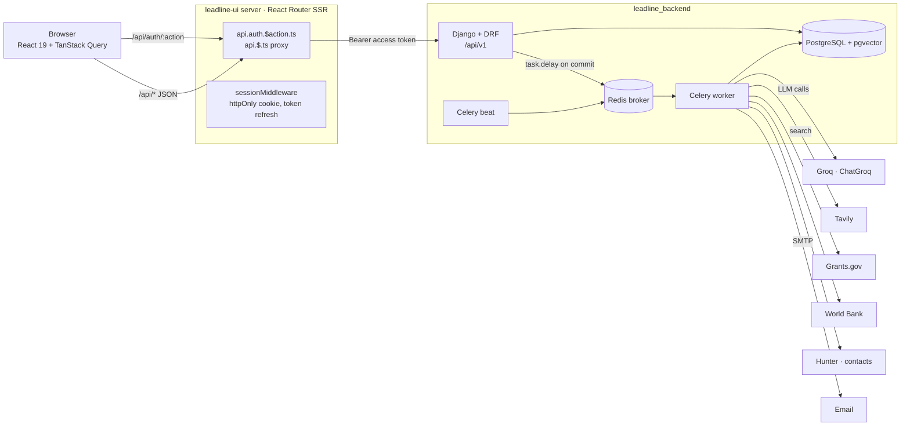
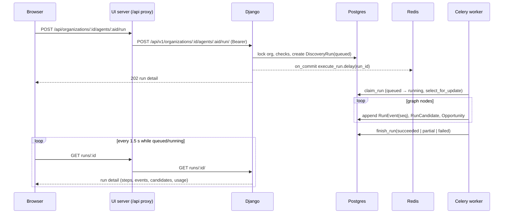
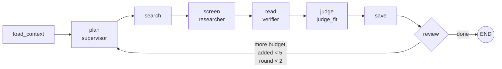

# Leadline — System & Architecture Details

Snapshot: 2026-10-13. Covers both repos:

- **leadline-ui** — React Router 8 SSR frontend + BFF (this repo)
- **leadline_backend** — Django 5.2 API + Celery workers + LangGraph agents (`../leadline_backend`)

Leadline helps organizations discover opportunities — grants & funding, tenders &
RFPs, partnerships, events & awards. AI agents search sources (open web, grant
databases, procurement portals, news), verify and score what they find; people
configure the agents, triage the feed, and draft proposals and outreach.

---

## 1. High-level architecture



Key properties:

- The browser **never** talks to Django directly and never sees a backend token.
  All calls go to the UI server (`/api/...`), which attaches the access token
  from a signed httpOnly cookie.
- Long work (agent runs, document processing, dossier, proposals, outreach) runs
  in **Celery** workers. The API returns `202` and the UI **polls**.
- No push channel (no SSE / websockets).

---

## 2. Frontend — leadline-ui

### 2.1 Stack

React 19.3, React Router 8 (SSR, middleware), Vite 7, TypeScript 5.9 strict,
Tailwind 4 + shadcn/ui + Radix, TanStack Query (server state), Redux Toolkit (UI
state only: table filters, modals), React Hook Form + Zod, Axios, Vitest, pnpm 9.

### 2.2 Shells & routes

| Shell      | File                              | Routes                                                                 |
| ---------- | --------------------------------- | ---------------------------------------------------------------------- |
| Marketing  | `components/root-layout.tsx`      | `/`, `/about`                                                          |
| Auth       | `components/auth-layout.tsx`      | login, register, verify-email, forgot/reset password, `/invite/:token` |
| Onboarding | `routes/onboarding.tsx`           | create org (basics → what you do → preferences → invites)              |
| Dashboard  | `components/dashboard-layout.tsx` | `/app`, `/account`, `/invitations`, `/o/:slug/*`                       |

Org area (`routes/o.$slug.*`): overview, opportunities (+ detail with reviews,
proposal, contacts, outreach), agents (create/edit sheet), runs (+ run detail),
outreach, calendar/deadlines, team, settings (general, integrations — static "Coming soon").

`/o/:slug` resolves the org client-side (`useOrgBySlug`). `/app` picks the
landing org (`resolveLandingPath`, `lib/org/last-org.ts`).

### 2.3 Auth (BFF + httpOnly session)

- Cookie `__leadline_session` (`lib/auth/session.server.ts`), signed with
  `SESSION_SECRET`, holds **only the access + refresh JWTs**.
- `API_URL` is required (`backendUrl()` throws without it). The browser posts
  JSON to `routes/api.auth.$action.ts`, which calls Django and stores tokens in
  the cookie; the root loader returns only `{user, isAuthenticated}`.
- `sessionMiddleware` refreshes an expired access token server-side (shared
  between concurrent requests), loads the profile, clears the cookie when refresh
  is rejected. `requireSession` guards dashboard and onboarding with `redirect()`.

BFF actions (`POST /api/auth/:action`, JSON only, same-site only, Zod-validated):

| Action                | Django path                  | Notes                             |
| --------------------- | ---------------------------- | --------------------------------- |
| `login`               | `/auth/login/`               | tokens → cookie, returns `{user}` |
| `register`            | `/auth/register/`            | → verify-email                    |
| `verify-email`        | `/auth/verify-email/`        | 6-digit `otp_code`                |
| `resend-verification` | `/auth/resend-verification/` |                                   |
| `forgot-password`     | `/auth/forgot-password/`     |                                   |
| `reset-password`      | `/auth/reset-password/`      | email + code                      |
| `change-password`     | `/auth/change-password/`     | session required                  |
| `change-email`        | `/auth/change-email/`        | ends session                      |
| `profile`             | `/auth/profile/` (PATCH)     | session required                  |

`GET /api/auth/me` → `{user, isAuthenticated}`. Logout = `DELETE /auth/session`
(revokes refresh token).

### 2.4 API layer

- `lib/api/client.ts`: axios, `baseURL: '/api'`, header `X-Requested-With: leadline`,
  401 → clear session → `/auth/login`. Every request goes to the proxy below.
- `routes/api.$.ts` (proxy) forwards to `${API_URL}/<path>/?<query>`:
  - adds Django trailing slash, `Authorization: Bearer <access>` from session
  - refuses: cross-site (403), dot/empty/backslash segments (404), `auth/*` (404),
    non-JSON body (415) except multipart with
    `X-Requested-With: leadline`
  - timeouts: 15 s; 300 s for multipart and `/download`, `/export`, `/calendar`
  - returns status + JSON only; non-JSON → `{detail}`; file responses pass only
    `Content-Type`/`Content-Disposition`/`Content-Length`; backend cookies never
    forwarded; network error → 503
- Helpers (`lib/api/backend.ts`): `orgApi(orgId, path)` = `/organizations/:id/...`, `repeatParams` (DRF repeated
  keys), `downloadFile()`.
- DTO mapping: snake_case → UI types in `lib/schema/backend.schema.ts`
  (agents, runs, opportunities, reviews, overview, DRF pages) and
  `lib/schema/leadline.schema.ts` (proposals, contacts, outreach, deadlines,
  insights, reminders).

### 2.5 Feature → endpoint map

`O` = `/organizations/:id`.

| Feature             | Endpoints                                                                                                                                        | Status                       |
| ------------------- | ------------------------------------------------------------------------------------------------------------------------------------------------ | ---------------------------- |
| Orgs                | `/organizations`, `O`, `O/{archive,restore,leave}`, `O/preferences`, `O/setup`, `O/links[/:id]`                                                  | Live                         |
| Knowledge           | `O/folders[/:id]`, `O/documents[/:id][/download\|/reprocess]` (`?folder=`), `O/dossier`, `O/dossier/regenerate` (poll 3 s), `O/run-settings`     | Live                         |
| Invitations         | `/organizations/invitations/{preview,accept,decline,received[/:id/accept\|decline]}`, `O/invitations[/:id/{resend,revoke}]`                      | Live                         |
| Agents              | `O/agents[/:aid]`, `POST O/agents/:aid/run`                                                                                                      | Live                         |
| Runs                | `O/runs?page&page_size&agent&status`, `O/runs/:id` (poll 1.5 s)                                                                                  | Live                         |
| Opportunities       | `O/opportunities` (filters), `O/opportunities/:id` GET/PATCH                                                                                     | Live                         |
| Overview / insights | `O/overview`, `O/insights?days=`                                                                                                                 | Live                         |
| Reviews             | `O/opportunities/:oid/reviews`, `O/rejection-reasons`                                                                                            | Live, backend-only           |
| Proposals           | `O/opportunities/:oid/proposal`, `O/proposals/:pid/{events,versions,sections/:key[/rewrite],export}`                                             | Live, backend-only           |
| Outreach            | `O/opportunities/:oid/{contacts,contact-search,outreach}`, `O/contacts/:id`, `O/outreach[/:id/{redraft,discard,approve}]`, `O/outreach-purposes` | Live, backend-only           |
| Deadlines           | `O/deadlines`, `O/deadlines/calendar`, `O/opportunities/:oid/calendar`, `O/reminders`                                                            | Live, backend-only           |
| Team roster         | `O/members` GET, `O/members/:id` PATCH role / DELETE, `O/leave`                                                                                  | Live                         |
| Integrations        | — (static catalog in `app/data/integrations.ts`)                                                                                                 | Coming soon (no backend app) |

There is no mock: tests use MSW (`app/test/msw.ts`) with the captured backend
fixtures in `lib/schema/__fixtures__/backend/`.

### 2.6 Agent run in the UI

1. "Run now" (`features/agents/agent-tile.tsx`), overview "Search for
   opportunities" (pop-up `components/org/run-dialog.tsx`: _Run with my
   settings_ = no body, _Configure this run_ = `{depth, sources,
opportunity_types, folders}`), or "Run again" → `useRunAgent({ agentId,
settings? })` (`features/agents/mutations.ts`) → `POST O/agents/:aid/run`.
   The backend resolves each setting: request body → agent (sources, types,
   keywords) → org run settings (depth, folders); the depth's budget from
   `sources.yaml` (quick / standard / deep) and the folders are frozen on the run.
2. 202 response parsed with `runDetailDtoSchema`, seeded into
   `runKeys.detail` cache; agents/overview/runs/opportunities invalidated.
3. Navigate to `/o/:slug/runs/:id`.
4. `useRun` (`features/runs/queries.ts`) polls every 1500 ms while status is
   `queued|running`; `useRuns` polls lists every 4000 ms while any row is active.
5. The run page renders the polled run directly: each step's status and events,
   progress = settled steps / 5, live counts.
6. "About this run" shows `usage`, `modelsUsed`, `promptVersions`.

### 2.7 Env (UI)

| Var                                                                                                                                                        | Scope  | Purpose                                                        |
| ---------------------------------------------------------------------------------------------------------------------------------------------------------- | ------ | -------------------------------------------------------------- |
| `API_URL`                                                                                                                                                  | server | **Required.** Django base, e.g. `http://127.0.0.1:8000/api/v1` |
| `SESSION_SECRET`                                                                                                                                           | server | cookie signing; required in production                         |
| `VITE_APP_NAME`, `VITE_APP_VERSION`, `VITE_SITE_URL`, `VITE_GTAG_ID`, `VITE_SENTRY_DSN`, `VITE_SENTRY_ENVIRONMENT`, `VITE_ENABLE_DEVTOOLS`, `VITE_NOINDEX` | client | optional                                                       |

---

## 3. Backend — leadline_backend

### 3.1 Stack

Django 5.2, DRF, simplejwt (+ blacklist), drf-spectacular (`/api/docs/`,
`/api/schema/`), Celery 5.6 + Redis, PostgreSQL 15+ with pgvector, fastembed
(local embeddings), LangGraph + langchain-groq, trafilatura + httpx, python-docx.

Conventions: IDs are 12-char ShortUUIDs; lists are DRF pages
(`count, next, previous, results`) unless noted; errors `{detail, code}`.

### 3.2 Apps

| App              | Responsibility                                                                                |
| ---------------- | --------------------------------------------------------------------------------------------- |
| `authentication` | User, JWT, email OTP verification, password reset/change, profile                             |
| `organizations`  | Org, profile, preferences, links, documents, members, invitations, activity log, setup status |
| `knowledge`      | Document text extraction, chunks + pgvector embeddings, CompanyDossier                        |
| `discovery`      | SearchAgent, DiscoveryRun, RunEvent, RunCandidate, scheduled runs                             |
| `opportunities`  | Feed, triage, reviews, overview, insights, dedupe, decision memory                            |
| `learning`       | Preference suggestions from rejections, evals (`run_evals`)                                   |
| `proposals`      | Proposal, versions, events, section rewrite, DOCX export                                      |
| `outreach`       | Contacts, contact search (lead scout), AI outreach emails, deadlines, reminders               |
| `ai`             | Agent layer: LLM factory, prompts, LangGraph graphs, tools (no models/URLs)                   |
| `common`         | Base model, `seed` command, API helpers                                                       |

### 3.3 API map (`/api/v1`)

`O` = `organizations/<org>/`.

**Auth** `auth/`: `register`, `login`, `refresh-token`, `logout`,
`verify-email`, `resend-verification`, `forgot-password`, `reset-password`,
`change-password`, `change-email`, `profile` (GET/PUT).

**Organizations**: `organizations/` (GET, POST); `O` (GET, PATCH);
`O/{archive,restore,leave}/`; `O/members/[<id>/]` (GET, PATCH, DELETE);
`O/invitations/` (+ `bulk/`, `<id>/resend/`, `<id>/revoke/`);
`organizations/invitations/{preview,accept,decline}/`,
`organizations/invitations/received/[<id>/{accept,decline}/]`;
`O/activity/`; `O/setup/` (`ready_for_matching` gates runs);
`O/preferences/`; `O/links/[<id>/]`; `O/folders/[<id>/]` (name, purpose,
document_count; only empty folders can be deleted, 409);
`O/documents/[<id>/[download/]]` (upload needs `folder_id`; `?folder=`; PATCH
`folder_id` moves). `O/run-settings/` (GET members, PUT admins: depth, sources,
opportunity_types, folders).

**Knowledge**: `O/dossier/` (status, content, version, generated_at, error,
prompt_id, model); `O/dossier/regenerate/` (202, admin);
`O/documents/<id>/reprocess/` (202, admin).

**Discovery**: `O/agents/` (plain array, GET/POST); `O/agents/<a>/`
(GET/PATCH/DELETE); `O/agents/<a>/run/` (POST → 202 run detail);
`O/agent-sources/`; `O/runs/` (paged, `?agent=`, repeatable `?status=`);
`O/runs/<r>/`; `O/runs/<r>/events/?after=N`.

**Opportunities**: `O/opportunities/` (filters `type`, `status`, `agent`,
`saved`, `search`, `min_score`, `deadline_before`, `review`, `sort`);
`O/opportunities/<id>/` (GET, PATCH `status|saved|notes` — approve/reject must
use a review, `code=use_review`); `O/opportunities/<id>/reviews/` (POST
`{decision, reason?, comment?}` → `{review, opportunity}`);
`O/rejection-reasons/`; `O/overview/`; `O/insights/?days=7|30|90|180|365`.

**Learning**: `O/preference-suggestions/[<id>/{accept,dismiss}/]`.

**Proposals**: `O/proposals/`; `O/opportunities/<id>/proposal/` (GET, POST);
`O/proposals/<p>/`, `events/`, `versions/[<n>/[restore/]]`,
`sections/<key>/` (PATCH), `sections/<key>/rewrite/`, `export/` (DOCX).

**Outreach**: `O/opportunities/<id>/{contacts,contact-search,outreach}/`;
`O/contacts/<id>/`; `O/outreach/[<e>/[{redraft,discard,approve}/]]` (approve =
admin, sends); `O/outreach-purposes/`; `O/deadlines/[calendar/]`;
`O/opportunities/<id>/calendar/`; `O/reminders/`.

### 3.4 Background jobs

| Job                             | Trigger                          | Does                           |
| ------------------------------- | -------------------------------- | ------------------------------ |
| `discovery.execute_run`         | `POST …/run/`, scheduler         | Runs the discovery graph       |
| `run_scheduled_agents`          | beat, hourly                     | Starts `daily`/`weekly` agents |
| document processing             | upload / reprocess               | Extract → chunk → embed        |
| dossier generation              | documents processed / regenerate | Writes CompanyDossier          |
| `opportunities.embed_review`    | each review                      | Decision memory embedding      |
| `learning.refresh_suggestions`  | each rejection                   | Preference suggestions         |
| `proposals.run_proposal_job`    | approval signal / POST proposal  | Proposal graph                 |
| contact search / outreach draft | POST endpoints                   | Lead scout / emailer agents    |
| `send_deadline_reminders`       | beat, daily 07:00                | Reminder emails                |

---

## 4. AI agentic flow (discovery)

### 4.1 Trigger & lifecycle



`services.start_run` (`apps/discovery/services.py`) checks, in order:

1. Caller is admin or agent owner.
2. Agent enabled — else 409 `agent_disabled`.
3. `setup_status()["ready_for_matching"]` — else 409 `setup_incomplete`.
4. Expires stale runs (> `DISCOVERY_STALE_RUN_MINUTES`, default 20).
5. No active run for the org — else 409 `run_in_progress` (also a partial
   unique DB constraint `discovery_one_active_run_per_org`).

The run freezes `config = {opportunity_types, keywords, sources, match_threshold}`
and `budget`, and records `runner = DISCOVERY_RUNNER`.

### 4.2 Runners

| Runner               | File                                 | Behaviour                                                                                             |
| -------------------- | ------------------------------------ | ----------------------------------------------------------------------------------------------------- |
| `fake` (**default**) | `apps/ai/graphs/fake_discovery.py`   | Scripted events, `[Sample]` opportunities, no API keys, sleeps `DISCOVERY_FAKE_STEP_SECONDS` per step |
| `graph`              | `apps/ai/graphs/discovery/runner.py` | Real LangGraph pipeline below                                                                         |

### 4.3 Graph



| Node           | UI step | What it does                                                                                                                                                                        |
| -------------- | ------- | ----------------------------------------------------------------------------------------------------------------------------------------------------------------------------------- |
| `load_context` | profile | Loads org profile + dossier (warns if no dossier)                                                                                                                                   |
| `plan`         | profile | Supervisor returns `SearchPlan` of (source, query); fallback from keywords/dossier/sectors                                                                                          |
| `search`       | search  | Calls sources; normalises URLs; skips URLs seen this run or already in feed                                                                                                         |
| `screen`       | search  | Researcher picks ≤ 15 leads per round                                                                                                                                               |
| `read`         | read    | Fetches page (source reader, fallback `HttpFetcher` + trafilatura); verifier returns `VerifiedOpportunity`; code rejects closed/past-deadline/wrong-type/excluded funder or keyword |
| `judge`        | match   | Pulls similar past decisions (pgvector, top 4); `judge_fit` → 0–100 score, reasons, concerns                                                                                        |
| `save`         | save    | `record_candidate` per candidate                                                                                                                                                    |
| `review`       | search  | Code-only stop rule                                                                                                                                                                 |

Read and judge run in a `ThreadPoolExecutor` (`max_concurrency = 4`).

### 4.4 Models (Groq only)

`apps/ai/llm.py` builds `ChatGroq`; `apps/ai/config/models.yaml` maps role → tier:

| Tier (env)       | Roles                                        | Suggested model       |
| ---------------- | -------------------------------------------- | --------------------- |
| `ANSWER_MODEL`   | supervisor, judge, drafter, dossier, emailer | `openai/gpt-oss-120b` |
| `RESEARCH_MODEL` | researcher, verifier, lead_scout             | `openai/gpt-oss-20b`  |
| `LIGHT_MODEL`    | classifier                                   | —                     |

Structured output via JSON schema (`apps/ai/structured.py`). Prompts are
versioned files `apps/ai/prompts/<role>/vN.md` (judge v2 adds past decisions).
Each run records `prompt_versions` and `models_used`. Optional LangSmith tracing.

### 4.5 Sources & tools

| UI category                         | Backend sources                       |
| ----------------------------------- | ------------------------------------- |
| `web` (Open web)                    | `web_search` (Tavily)                 |
| `grants` (Grant databases)          | `grants_gov`, `web_search`            |
| `procurement` (Procurement portals) | `world_bank`, `web_search`            |
| `news` (News & announcements)       | `news_search` (Tavily, news, 45 days) |

Defined in `apps/ai/config/sources.yaml`. The UI's static `AGENT_SOURCES`
(`app/data/integrations.ts`) uses the same category IDs.

Fetcher honours robots.txt and has an SSRF guard (`tools/http.py`). Hunter
powers contact search; `tools/knowledge.py` searches org document chunks for
proposals.

### 4.6 Budget, scoring, dedupe

- Budget (`sources.yaml`): 12 searches, 40 pages (soft — stop fetching, still
  score), 200k tokens and 600 s wall (hard — stop model calls; 3000-token
  reserve). Any stop reason or warning → run `partial`.
- `match_score < 55` → `below_threshold`.
- Otherwise dedupe per org on `dedupe_key` (sha256 of normalised URL) or
  `title_key` (sha256 of title + funder) → `duplicate`, else create
  `Opportunity(status=new)` → `added`. DB unique `(organization, dedupe_key)`.
- Every scored candidate becomes a `RunCandidate` row.

### 4.7 Enums

- Run status: `queued | running | succeeded | partial | failed`
- Steps: `profile, search, read, match, save`; step status:
  `pending | running | done | warning | failed | skipped`
- Event level: `info | warning | error`
- Candidate decision: `added | duplicate | below_threshold`
- Trigger: `manual | schedule`; schedule: `manual | daily | weekly`
- Opportunity status: `new | reviewing | pursuing | submitted | won | lost | dismissed`
- Proposal status: `queued | drafting | ready | failed`; steps
  `requirements, outline, evidence, draft, review`

### 4.8 Run DTOs

- **List item**: `id, agent, agent_name, trigger, status, created_at,
started_at, finished_at, duration_ms, sources_scanned, pages_read, found,
error, runner`
- **Detail**: list fields + `budget, usage{searches,pages,tokens,seconds},
prompt_versions, models_used, last_event_seq, steps[5], candidates[]`
  - step: `{key, label, status, started_at, duration_ms, events[]}`
  - event: `{seq, step, level, message, tool, source, url, data, at}`
  - candidate: `{title, funder, source_name, source_url, opportunity_type,
match_score, match_reasons[], decision, opportunity}`
- **Events page** `runs/<r>/events/?after=N`: `{run_status, last_seq, events}`
  (≤ 500 per call) — not used by the UI yet.

### 4.9 Downstream of discovery

Approve review → `opportunity_approved` signal → proposal job (graph or fake per
`PROPOSAL_RUNNER`) → proposal sections drafted with org knowledge → editable,
versioned, DOCX export. Reviews also feed decision memory (embeddings used by
future `judge` calls) and rejections feed preference suggestions.

---

## 5. Running locally end to end

### 5.1 Backend

Requirements: Python 3.12, PostgreSQL 15+ with `vector` extension (also in
`template1` for tests), Redis 6+. fastembed downloads ~70 MB on first use.

```bash
cd ../leadline_backend
make install
make migrate
make check
make seed            # demo org "Tujenge Data Initiative", 2 agents, 6 runs, 12 opportunities
make run             # Django on :8000
make celery          # REQUIRED — without it runs stay "queued"
make celery-beat     # optional: scheduled agents, deadline reminders
python manage.py ai_ping   # verify AI keys
```

Seed logins: `amina.otieno@example.org` (admin), `brian.kamau@example.org`
(member), password `LeadlineDemo2026!`.

Backend `.env` for **real** AI (defaults are fake runners):

```
DISCOVERY_RUNNER=graph
PROPOSAL_RUNNER=graph
GROQ_API_KEY=...
LIGHT_MODEL=...
RESEARCH_MODEL=openai/gpt-oss-20b
ANSWER_MODEL=openai/gpt-oss-120b
TAVILY_API_KEY=...
HUNTER_API_KEY=...        # optional
```

Dossier, lead scout and emailer always use real models → need `GROQ_API_KEY`
even with fake runners. System checks warn: W001 fake runner outside DEBUG,
W002 graph runner without Tavily key.

Other backend env groups (`.env.example`): Django, DB, CORS/CSRF
(`CORS_ALLOWED_ORIGINS`, `CSRF_TRUSTED_ORIGINS`), Celery, JWT/OTP/throttles,
email, organizations, knowledge/embeddings, discovery, agent tools, LangSmith,
proposals, outreach/deadlines/schedules.

### 5.2 Frontend

```bash
# .env
API_URL=http://127.0.0.1:8000/api/v1
SESSION_SECRET=<random string>

pnpm install
pnpm dev             # http://localhost:5173
```

`API_URL` is required — without it the server refuses to render. Sign in with a
backend seed account (`make seed`).

### 5.3 Smoke test

1. Sign in (or register → verify email code).
2. Finish org setup until the overview checklist is complete
   (`ready_for_matching`), else runs return 409 `setup_incomplete`.
3. Upload a document; wait for document status `processed` and dossier ready.
4. Agents → Run now → run page should go `queued → running → succeeded/partial`
   with step events.
5. Approve an opportunity → proposal goes `queued → drafting → ready`.

---

## 6. Known gaps

### Frontend

- Integrations are a static "Coming soon" catalog; backend has no integrations app.
- Team roster shows only backend fields (no title/department/availability).
- Run page re-fetches full detail every 1.5 s; incremental
  `runs/<r>/events/?after=` unused.
- `AGENT_SOURCES` static; `O/agent-sources/` unused (IDs currently match).
- Candidate precise kind collapsed to feed type (`other` falls back to `grant`);
  event `data/seq/step` dropped.
- Not yet used from backend `a098f5c` (2026-10-13): run `opportunities[]`
  (what each run added), `?run=` opportunity filter, opportunity `brief`
  and `O/opportunities/:id/brief/` (GET generates synchronously if missing —
  would exceed the proxy's 15 s timeout; POST regenerates).

### Backend (owned by backend team — see `../leadline_backend/docs/team-plan.md`)

- Agent fixes landed in `a098f5c` (researcher prompt v2, verifier, supervisor,
  lead scout logging) — real-run quality still to be confirmed.
- No run cancel; stale run blocks org until 20-min expiry (checked lazily on
  next start). One active run per org.
- Polling only, no push channel.
- Planned: agents reading folders (search limited to a run's folders,
  `folder_summarizer`), org-specific sources + `source_reader`, EU/TED sources,
  cost per run, OCR, PDF export, new-finds digest email.

---

## 7. Key file index

### leadline-ui

| Concern               | File                                                                                                          |
| --------------------- | ------------------------------------------------------------------------------------------------------------- |
| API client            | `app/lib/api/client.ts`                                                                                       |
| Proxy                 | `app/routes/api.$.ts`                                                                                         |
| Auth BFF              | `app/routes/api.auth.$action.ts`, `app/lib/auth/*.server.ts`                                                  |
| Backend helpers       | `app/lib/api/backend.ts`                                                                                      |
| DTO schemas           | `app/lib/schema/backend.schema.ts`, `app/lib/schema/leadline.schema.ts`, `app/lib/schema/agent-run.schema.ts` |
| Run trigger / polling | `app/features/agents/mutations.ts`, `app/features/runs/queries.ts`                                            |
| Run page              | `app/routes/o.$slug.runs.$id.tsx`                                                                             |
| Tests (MSW)           | `app/test/msw.ts`, `app/lib/schema/__fixtures__/backend/`                                                     |

### leadline_backend

| Concern           | File                                                                                  |
| ----------------- | ------------------------------------------------------------------------------------- |
| URLs              | `config/urls.py`, `config/api_router.py`, `apps/*/api/urls.py`                        |
| Run start / state | `apps/discovery/services.py`, `apps/discovery/tasks.py`, `apps/discovery/recorder.py` |
| Run DTOs / steps  | `apps/discovery/api/serializers.py`, `apps/discovery/selectors.py`                    |
| Runner registry   | `apps/ai/graphs/discovery_runner.py`                                                  |
| Graph             | `apps/ai/graphs/discovery/{builder,nodes,runner}.py`                                  |
| Agents            | `apps/ai/agents/{supervisor,researcher,verifier,judge}.py`                            |
| LLM / prompts     | `apps/ai/llm.py`, `apps/ai/config/models.yaml`, `apps/ai/prompts/`                    |
| Sources / budget  | `apps/ai/config/sources.yaml`, `apps/ai/tools/`, `apps/ai/graphs/budget.py`           |
| Dedupe / feed     | `apps/opportunities/services.py`, `apps/opportunities/dedupe.py`                      |
| Proposals         | `apps/proposals/receivers.py`, `apps/ai/graphs/proposal/`                             |
| Celery            | `config/celery.py`, `config/settings/base.py`                                         |
